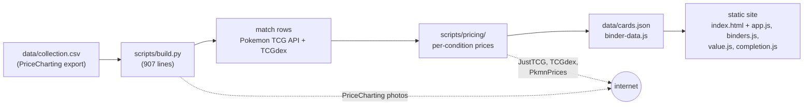
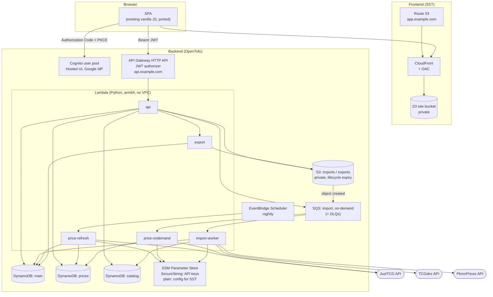
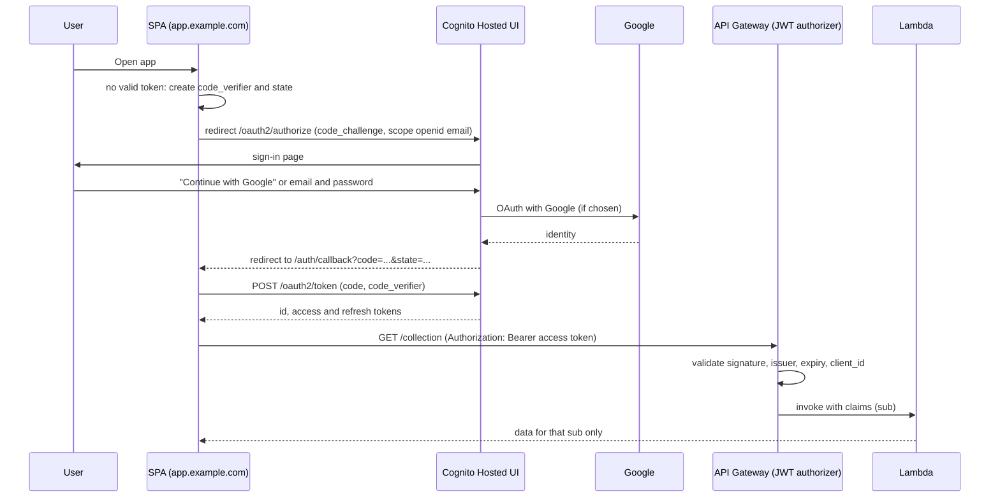
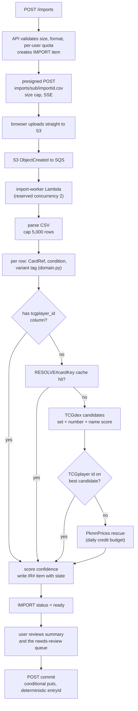
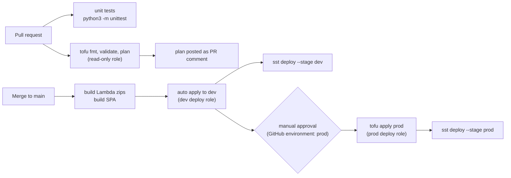

# Virtual Binder on AWS: a hosted, multi-user design

Status: proposal. Written 2026-11-18. Nothing here is built yet.

This document proposes taking Virtual Binder from "a PriceCharting export turned into a static page by a local Python script" to "a small hosted app where people sign in, keep their own collection, and see current per-condition prices". It is written against the code as it is today (`scripts/build.py`, `scripts/pricing/`) so most of the pricing and matching logic can move to Lambda as it stands.

Figures for prices and quotas were checked against the vendors' public pages on 2026-11-18 where noted; everything marked **(verify)** was written from memory or inference and must be re-checked before it drives a decision. All cost numbers are estimates.

## Contents

1. [Goals and non-goals](#1-goals-and-non-goals)
2. [Where the code is today and what can be reused](#2-where-the-code-is-today-and-what-can-be-reused)
3. [Architecture](#3-architecture)
4. [Data model](#4-data-model)
5. [API](#5-api)
6. [Authentication](#6-authentication)
7. [Import pipeline](#7-import-pipeline)
8. [Price refresh and the JustTCG budget](#8-price-refresh-and-the-justtcg-budget)
9. [Cost estimate](#9-cost-estimate)
10. [Security](#10-security)
11. [Repository layout, environments and state](#11-repository-layout-environments-and-state)
12. [CI/CD](#12-cicd)
13. [Migration from the static build](#13-migration-from-the-static-build)
14. [Milestones](#14-milestones)
15. [Risks](#15-risks)
16. [Open questions](#16-open-questions)

## 1. Goals and non-goals

### Goals

1. **Disconnect from PriceCharting entirely** in the hosted app. No PriceCharting prices, no PriceCharting photo scraping, no dependency on its site. A PriceCharting export is only ever a *file a user uploads once*.
2. **Import once, then the app owns the data.** A user uploads a PriceCharting export or a generic CSV (columns: `name, set, number, printing, condition, qty, folder, notes`, plus optional `tcgplayer_id`, `cost_per_card`). Import matches each row to a TCGplayer product ID (TCGdex first, PkmnPrices as the rescue) and writes the app's own collection. From then on that collection is the source of truth; the CSV is not read again.
3. **Manage the collection in the app.** Search the card catalog (TCGdex), add a card with printing, condition, quantity and folder, edit or delete entries, and export the whole collection as CSV or JSON at any time.
4. **One price source: JustTCG**, by TCGplayer product ID and condition. The labelled PriceCharting fallback in the current build is dropped. A row with no usable price shows "no price" with a reason. Rows that could not be matched at import go to a user-facing **needs review** queue where the user can pick the right card or pin a TCGplayer ID by hand.
5. **Cheap to run**: serverless, no always-on resources, roughly $1-3 a month of AWS spend at hobby scale (section 9).
6. **Keep the local mode.** The offline `python3 scripts/build.py` flow keeps working for anyone who does not want an account.

### Non-goals (for now)

- Non-English cards (TCGplayer is English-only; the current build already skips them).
- Graded cards (PSA/BGS/CGC): JustTCG's per-condition prices are for raw cards.
- Sealed product, other trading card games, a marketplace, trading, social features, shared or public collections.
- A native mobile app. The site stays a responsive web app.
- Real-time prices or intraday history. Prices refresh nightly at best (section 8).
- Replacing the Pokédex, My Binders, Value and Set Completion tabs. They are ported after the core loop works (milestone M5), not redesigned.

## 2. Where the code is today and what can be reused



Everything is computed at build time on one machine and loaded by the page as a JavaScript global. There is no server, no user concept, and state such as picks and binders lives in the browser's `localStorage`.

### What the `scripts/pricing/` package gives us

The package was written to be independent of the CSV and the build, so most of it ports unchanged. The only adaptations are storage (JSON files become DynamoDB) and secrets (environment variables become SSM).

| Module | What it does | Reuse in the hosted app |
| --- | --- | --- |
| `domain.py` | `Condition` and `Printing` enums, `parse_condition`, `parse_variant_tag`, `select_printing`, `CardRef`, `PriceResult`. Pure functions, no I/O | Shared library, as is. Used by the API (validating enums), the importer (mapping CSV text to condition and printing) and the price reader |
| `justtcg.py` | `JustTcgClient`: batched requests by product ID and condition, per-run request budget, quota metadata, `ProviderError`, `chunk_unique_ids` | Nightly refresh Lambda and the on-demand worker. Change: make the batch size a parameter (20 on the free tier, 100 on Starter) instead of the `BATCH = 20` constant |
| `catalog.py` | `CardCatalog.search` (TCGdex), `find_tcgplayer_id` (TCGdex, then PkmnPrices rescue), `IdLookup` with a `transient` flag | `GET /catalog/search` and the importer. It already takes the HTTP fetcher as a callable, so the file cache is replaced by a DynamoDB-backed one |
| `service.py` | `PricingService.price_many`, `pick_price`, the ID registry and price cache flow | Split in two for hosting: a **read path** (cache only, used by the API) and a **refresh path** (calls JustTCG, used by the jobs). `pick_price` is reused by both |
| `store.py` | `TtlCache` and `IdRegistry` backed by JSON files | Replaced by DynamoDB implementations of the same small interface (`get`, `put`, `put_miss`, TTL) |
| `collection.py` | Turns build rows into price items, applies the PriceCharting fallback, prints coverage | The row-to-`CardRef` adapter is reused by the importer. The fallback logic is deleted in the hosted app |
| `net.py` | `request_json` with 429 handling, `.env` and key loading | `request_json` as is. Key loading reads SSM instead of env/`.env` |

### What still lives in `build.py` and has to be extracted

`build.py` is not a library today. These parts are needed by the hosted app and must move into importable modules first (milestone M0):

- Set mapping: `SET_MAP`, `JA_SETS`, `resolve_set`, `set_catalogs`, and the matching helpers `norm_num`, `norm_name`, `name_score`, `slot_key`. The scoring closure `best()` is currently nested inside `main()`, and `set_key`/`species_key` helpers sit alongside.
- `parse_product` (splits `Name [Tag] #Number`, used for PriceCharting exports).
- TCGdex and Pokemon TCG API access (`dex_set`, `dex_card`, `ptcg_set`) and `dex_twin`.
- The view assembly (Pokédex species matching, sets, completion) used by the tabs. See open question 6.

Dropped in the hosted app: `pc_photo` and the other PriceCharting site fetches, `pick_price` (the condition-blind TCGdex price used by Set Completion), and the history snapshot writer (replaced by per-user snapshots in DynamoDB).

## 3. Architecture

### Components



Choices that keep it cheap and simple:

- **No VPC, NAT, RDS or load balancer.** Those are the line items that turn a hobby app into a $30+/month one. Lambdas call public APIs directly and DynamoDB over its public endpoint.
- **Python on arm64 Lambda, standard library only**, like the current code. No layers needed: the shared package is copied into each function zip.
- **DynamoDB on demand**, no capacity planning. Three tables because they have different owners, lifetimes and IAM needs (section 4).
- **SQS in front of the workers** so imports and on-demand price fetches run at a controlled concurrency (reserved concurrency of 1-2). That is how the JustTCG per-minute limit (10/min on the free tier) and the PkmnPrices daily limit are respected.
- **Two separate deploy tools, one contract.** SST owns the static site; OpenTofu owns everything else. OpenTofu publishes the values the frontend needs to SSM; SST reads them at build time.

### Frontend (SST)

- `sst.aws.StaticSite` builds and uploads the SPA to a private S3 bucket behind CloudFront with Origin Access Control (OAC) **(verify that the current SST version uses OAC rather than OAI)**.
- Custom domain `app.example.com` through Route 53 and an ACM certificate in `us-east-1` (CloudFront requirement). SST can create the certificate and DNS validation records itself.
- SST reads the API URL, Cognito pool ID and client ID from SSM (`/virtual-binder/<stage>/api_url` and so on) when it builds, and injects them as build-time environment variables. The SPA contains no secrets, only public identifiers.
- SPA fallback: CloudFront custom error response maps 403/404 to `/index.html` if the SPA uses client-side routes. The current page uses hash routes, so this may not be needed.

### Backend (OpenTofu)

Modules live in `infra/modules/` in this repo (plain OpenTofu, no external module registry needed):

| Module | Resources |
| --- | --- |
| `auth` | Cognito user pool (tier via a variable), Hosted UI domain, Google identity provider, public app client (no secret), `prevent_destroy` |
| `data` | The three DynamoDB tables, GSIs, TTL attributes, PITR on `main`, deletion protection on `main` |
| `storage` | Private S3 bucket for imports and exports: block public access, SSE, lifecycle (imports expire after 7 days, exports after 1 day), CORS for presigned uploads from the app origin only |
| `api` | HTTP API, JWT authorizer, routes, stage throttling, custom domain `api.example.com` (regional ACM certificate), access-log group |
| `functions` | Lambda functions and per-function IAM roles, SQS queues and DLQs, event source mappings, EventBridge schedule |
| `config` | SSM parameters: SecureString placeholders for the API keys (values set out of band), plain parameters for the API URL and Cognito IDs |

The JustTCG and PkmnPrices keys are stored as SSM Parameter Store **SecureString** parameters (standard tier, encrypted with the AWS-managed `aws/ssm` key, no charge). OpenTofu creates the parameter with a placeholder and `ignore_changes = [value]`; the real value is set once with the AWS CLI, so it never enters OpenTofu state or the repo. Lambdas read it at cold start and keep it in memory. Secrets Manager is deliberately not used (about $0.40 per secret per month **(verify)**, no rotation need here).

This is a personal project: it uses its own self-contained OpenTofu modules (no external or shared module dependencies) and its own dedicated AWS account or profile.

## 4. Data model

Three tables. All are on-demand (PAY_PER_REQUEST), encryption at rest on (default).

### 4.1 `main`: everything owned by a user

Partition key `PK` (string), sort key `SK` (string). Every item that belongs to a user has `PK = USER#<cognito sub>`. The `sub` comes only from the verified JWT, never from the request.

| Item | PK | SK | Notes |
| --- | --- | --- | --- |
| Profile | `USER#<sub>` | `PROFILE` | email, createdAt, quota counters, settings |
| Collection entry ("stack") | `USER#<sub>` | `E#<entryId>` | one card + printing + condition + folder, with a quantity |
| Import | `USER#<sub>` | `IMPORT#<importId>` | status, row counts, source filename, timestamps |
| Import row | `USER#<sub>` | `IR#<importId>#<rowNo>` | raw row, parsed card, candidates, state: `matched`, `confirm`, `needs_review`, `skipped`, `committed` |
| Daily value snapshot (later) | `USER#<sub>` | `SNAP#<yyyy-mm-dd>` | total value, card count; one small item per user per day |
| Pick / custom binder (later) | `USER#<sub>` | `PICK#<dex>` / `BINDER#<id>` | replaces the browser `localStorage` copies |

**`entryId` is deterministic**: a hash of `tcgplayerId | printing | condition | folder`. Adding the same stack again therefore increments the quantity (`UPDATE ... ADD qty :n`) instead of creating a duplicate, and re-running an import or retrying a request is naturally idempotent.

Example entry (fake card):

```json
{
  "PK": "USER#11111111-2222-3333-4444-555555555555",
  "SK": "E#9f3a1c0d7b21",
  "entityType": "entry",
  "tcgplayerId": "100001",
  "tcgdexId": "xx1-001",
  "name": "Testmon",
  "setCode": "xx1",
  "setName": "Test Set",
  "number": "001",
  "printing": "Holofoil",
  "condition": "LP",
  "qty": 2,
  "folder": "Trade",
  "notes": "corner wear",
  "costCentsPerCard": 150,
  "source": "import",
  "matchConfidence": 1.0,
  "watchKey": "100001#LP",
  "gsi1pk": "USER#11111111-2222-3333-4444-555555555555#SET#xx1",
  "gsi1sk": "N#001#9f3a1c0d7b21",
  "addedAt": "2026-11-18T12:00:00Z",
  "updatedAt": "2026-11-18T12:00:00Z"
}
```

An entry stores **no price**. Prices are joined from the `prices` table when the collection is read, so a nightly refresh never has to rewrite user data.

**GSIs on `main`**

| Index | Key | Projection | Purpose |
| --- | --- | --- | --- |
| `gsi1` | `gsi1pk` = `USER#<sub>#SET#<setCode>`, `gsi1sk` = `N#<number>#<entryId>` | ALL | one user's cards in one set, in number order (set view, Set Completion) |
| `gsi-watch` | `watchKey` (partition), `PK` (sort) | KEYS_ONLY, **sparse** (only entries have `watchKey`) | the refresh planner scans this to get the distinct `tcgplayerId#condition` pairs across all users without reading user data |

Listing a whole collection is a single `Query` on `PK` with `begins_with(SK, "E#")`, paginated (1 MB per page). Folder filtering is done in the API on that result; collections are expected to be hundreds to a few thousand entries, so a dedicated folder index is not worth its write cost.

### 4.2 `prices`: shared across all users

Prices are not user data and are fetched once for everyone. This is also what makes the JustTCG budget workable (section 8).

| Item | PK | SK | Attributes |
| --- | --- | --- | --- |
| Listing set | `PX#<tcgplayerId>` | `COND#<NM\|LP\|MP\|HP\|DMG>` | `listings` (list of `{printing, price, status, updated}`), `fetchedAt`, `tier`, `ownedAt`, `expiresAt` (TTL) |
| Budget counter | `META#BUDGET#<yyyy-mm-dd UTC>` | `JUSTTCG` | `used`, `onDemandUsed`, `lastQuota` (from the API's `_metadata`) |

This is the same shape as `ProductPrices` / `Listing` in `scripts/pricing/justtcg.py`, so `to_json`/`from_json` map straight onto the item. The user's chosen printing is applied at read time with `pick_price` (`service.py`), exactly as the build does today, so a missing printing or condition is "no price, with a reason" and never another printing's price.

`expiresAt` is set to 60 days after the pair was last owned by anyone; DynamoDB TTL deletes abandoned items for free.

### 4.3 `catalog`: cached reference data

| Item | PK | SK | Notes |
| --- | --- | --- | --- |
| TCGdex card | `CARD#<tcgdexId>` | `V1` | trimmed card JSON: name, set, number, image, TCGplayer product ID, TTL 30 days |
| Set list | `SETS` | `en` | all English sets, refreshed weekly |
| Search cache | `SEARCH#<hash>` | `V1` | result of a name/set/number search, TTL 7 days |
| Resolved ID | `RESOLVE#<cardKey>` | `V1` | the shared ID registry: `cardKey` is `CardRef.key` from `domain.py`; stores `tcgplayerId`, `source` (`tcgdex`, `pkmnprices`, `manual`) or a recent miss with reason |

Resolved IDs are shared between users (the same card resolves the same way for everyone), so the PkmnPrices rescue is spent once per card across the whole user base. Per-user manual pins go on the user's own entry, not in this shared item.

### Why three tables

User data needs PITR and deletion protection; prices and catalog are rebuildable and expire. The refresh job can write `prices` but not `main`; the importer can write `catalog` and `main` but not `prices`. Separate tables make those IAM boundaries simple and keep a bug in one path from touching another's data.

## 5. API

HTTP API with a JWT authorizer on every route except `GET /health`. The caller's `sub` is read from `requestContext.authorizer.jwt.claims.sub`. Bodies are JSON, validated in the Lambda (section 10). Errors use `{"error": {"code": "...", "message": "..."}}`.

| Method | Path | Purpose | Request / response sketch |
| --- | --- | --- | --- |
| GET | `/health` | liveness, no auth | `{"ok": true}` |
| GET | `/me` | profile and quota usage | `{"email", "quotas": {"importsToday": 1, "refreshesToday": 3}}` |
| DELETE | `/me` | delete account and all data | `202`, async delete of all `USER#<sub>` items and S3 objects, then the Cognito user |
| GET | `/collection` | list entries with prices | query: `folder`, `set`, `cursor`; response: `{"entries": [{..., "price": {"cents", "printing", "condition", "asOf", "stale"} or {"reason"}}], "cursor"}` |
| POST | `/collection/entries` | add a stack | `{"tcgplayerId", "printing", "condition", "qty", "folder", "notes"}`; adds to qty if the stack exists; queues an on-demand price fetch if the pair has no price |
| PATCH | `/collection/entries/{entryId}` | edit qty, folder, notes, cost | folder change re-keys the stack (merge if the target exists) |
| DELETE | `/collection/entries/{entryId}` | delete a stack | `204` |
| POST | `/collection/entries:batch` | bulk edit or delete, up to 25 | `{"ops": [{"op": "delete", "entryId": "..."}]}` |
| GET | `/catalog/search` | search cards | query: `q`, `set`, `number`, `limit`; response: candidates with `tcgdexId`, `tcgplayerId` (may be null), set, number, image, available printings |
| GET | `/catalog/cards/{tcgdexId}` | one card with its printings | used by the add-card dialog |
| GET | `/catalog/sets` | English sets | cached, for pickers |
| POST | `/prices/refresh` | on-demand refresh for specific entries | `{"entryIds": [...]}` (max 20); rate-limited per user per day; returns `202` |
| POST | `/imports` | start an import | `{"filename", "format": "pricecharting\|generic", "sizeBytes"}` returns `{"importId", "upload": {"url", "fields"}}` (presigned POST) |
| GET | `/imports/{importId}` | status and counts | `{"status": "processing\|ready\|committed\|failed", "rows": {"matched": 212, "confirm": 20, "needsReview": 15, "skipped": 3}}` |
| GET | `/imports/{importId}/rows` | review list | query: `state`, `cursor`; each row has the raw row, the parsed card, and up to 5 candidates |
| POST | `/imports/{importId}/rows/{rowNo}/resolve` | resolve a row | `{"tcgplayerId", "printing"}` or `{"skip": true}` |
| POST | `/imports/{importId}/commit` | write matched and confirmed rows to the collection | idempotent; returns counts |
| POST | `/exports` | build an export | `{"format": "csv\|json"}` returns `{"exportId", "downloadUrl"}` (presigned GET, expires in minutes) |
| GET | `/collection/view` | the binder view model for the tabs (see open question 6) | same shape the static page gets today as `window.BINDER_DATA` |

The "needs review" queue is simply `GET /imports/{id}/rows?state=needs_review` plus a persistent entry point in the UI. Rows stay resolvable after the rest of the import is committed.

## 6. Authentication

Amazon Cognito user pool with the **Hosted UI**, Authorization Code flow with PKCE, a public app client (no client secret), and Google as an identity provider alongside email sign-up.



- **JWT authorizer**: issuer `https://cognito-idp.<region>.amazonaws.com/<poolId>`, audience the app client ID. Cognito access tokens carry `client_id` rather than `aud`; HTTP API authorizers accept either **(verify against current docs)**.
- **Token handling in the SPA**: keep the access and ID tokens in memory only. Keep the refresh token in `sessionStorage` or `localStorage` with a short validity (7 days), and refresh silently before expiry. There is no backend-for-frontend, so XSS is the main threat: strict Content-Security-Policy, no third-party scripts, no `innerHTML` with unescaped user text (the current code already escapes via `esc()`).
- **Refresh token rotation is an Essentials/Plus feature, not Lite** (Cognito feature table, checked 2026-11-18). With Lite, a stolen refresh token is valid until it expires.
- **Tier note (recommendation).** Cognito Lite and Essentials share the same free tier of 10,000 monthly active users for direct and social sign-in; above that Lite is about $0.0055 per MAU and Essentials about $0.015. At hobby scale both cost $0, and Essentials adds refresh-token rotation, passwordless and passkey sign-in, and the newer Managed Login. The design keeps the tier as a variable and defaults to what was asked for (Lite); **I recommend starting on Essentials** and revisiting only if the user base approaches 10,000 MAU. See open question 3.
- **Google IdP**: create an OAuth client in a personal Google Cloud project, add Cognito's `/oauth2/idpresponse` URL as a redirect URI, and pass the client ID and secret to OpenTofu as sensitive variables. The secret ends up in OpenTofu state, so the state bucket must be encrypted and tightly scoped (section 11).
- **Callback and logout URLs** are exact-match allow-lists per environment. No wildcard redirect URIs.
- **API calls use the access token.** The ID token is only used by the SPA to show the email.

## 7. Import pipeline



**Formats.**
- *PriceCharting export*: recognised by its header (`product-name`, `console-name`, `notes`, `quantity`, `folder`, `cost-basis-in-pennies`, ...). `parse_product` splits `Name [Tag] #Number`; `parse_condition` reads `notes`; `parse_variant_tag` reads the tag. The CSV's price column is ignored. Rows for the same card, printing, condition and folder are merged into one stack (quantities added, cost averaged).
- *Generic CSV*: `name, set, number, printing, condition, qty, folder, notes` with optional `tcgplayer_id`, `tcgdex_id`, `cost_per_card`. If `tcgplayer_id` is present the row skips matching entirely. The local build can emit this format, which is how an existing collection moves over without re-matching (section 13).

**Matching and confidence.** Matching reuses the existing set mapping and scoring (`resolve_set`, `best()`, `name_score`) and `CardCatalog.find_tcgplayer_id`:

| Result | Confidence | State |
| --- | --- | --- |
| Set, number and name all match exactly, one TCGplayer ID | 1.0 | `matched`, committed automatically on commit |
| Fuzzy name or the PkmnPrices rescue matched uniquely | 0.75-0.95 | `confirm`: shown with the proposed card, one click to accept |
| Ambiguous (several products), set mismatch, unsupported variant tag, no ID found | below 0.75 | `needs_review`: candidates listed, user picks one, searches, pins an ID, or skips |
| Non-English, or an ambiguous condition note such as "LP/MP" | n/a | `needs_review` with the reason, never a guess |

This keeps the current rule that **a price is only ever for the card's own condition and printing**; the import simply carries the same ambiguity handling (`select_printing`, "ambiguous is a miss") into a review UI instead of a build report.

**Idempotency.** The import ID is part of the S3 key and of every row's SK. Reprocessing the same S3 object (SQS redelivery) overwrites the same `IR#` items. Commit builds each entry with its deterministic `entryId` and writes with a condition, so clicking commit twice, or retrying after a timeout, cannot double quantities (a quantity increment is only applied for rows not yet marked `committed`, tracked on the row item in the same transaction).

**Limits.** 2 MB and 5,000 rows per file, 3 imports per user per day, a global PkmnPrices daily budget counter (configurable; the current build defaults to 100 lookups per run, and the plan limits should be checked **(verify)**). When the budget runs out, remaining rescue rows become `needs_review` with reason "lookup deferred", and a re-run the next day resolves them. Large files are split into chunks of about 200 rows across SQS messages so no single Lambda invocation gets near the 15-minute limit. Raw uploads expire after 7 days.

## 8. Price refresh and the JustTCG budget

### The constraint

JustTCG pricing page, checked 2026-11-18:

| Plan | Price | Requests / month | Requests / day | Requests / minute | Cards per request |
| --- | --- | --- | --- | --- | --- |
| Free | $0 | 1,000 | 100 | 10 | 20 |
| Starter | $19/mo + tax | 10,000 | 1,000 | 50 | 100 |
| Professional | $49/mo + tax | 50,000 | 5,000 | 100 | 100 |
| Enterprise | $149/mo + tax | 500,000 | 50,000 | 500 | 200 |

A request is one HTTP call regardless of how many cards it carries. Daily limits reset at 00:00 UTC; monthly limits reset on the billing date. **The free tier is stated to be for personal and non-commercial use**, so a hosted app with other people's accounts needs a legal read of the Terms (section 15) and probably the Starter plan before it is public.

### Strategy

1. **Refresh distinct `tcgplayerId#condition` pairs, never entries.** Ten users owning the same card at the same condition cost one lookup. The planner gets the distinct pairs by scanning the sparse `gsi-watch` index (KEYS_ONLY, so the scan reads almost nothing).
2. **Staleness tiers** decide how often each pair is refreshed:

   | Tier | Which pairs | Interval |
   | --- | --- | --- |
   | hot | last price at or above $20, or added or edited in the last 7 days, or opened in a card detail view recently | daily |
   | warm | $2 to $20 | every 3 days |
   | tail | under $2 | weekly |
   | unowned | nobody owns it | stop refreshing; TTL deletes it after 60 days |

   Thresholds are configuration, not code. The UI always shows the price's as-of date, so a weekly price is visibly weekly.
3. **Nightly planner.** EventBridge Scheduler triggers the `price-refresh` Lambda once a day shortly after the UTC reset (for example 00:30 UTC). It builds the due list, sorts by tier then age, caps it at the day's budget (see below), chunks it with `chunk_unique_ids` (the same product never appears twice in one request), and calls `JustTcgClient.fetch`. It paces itself to the per-minute limit (about 6.5 seconds between calls on Free; 80 calls take under 10 minutes). On a 429 it stops and leaves the remainder for tomorrow. It records `_metadata` (remaining daily and monthly requests) in the budget item and adapts the next day's cap.
4. **On-demand refresh for new cards.** When an entry is added and its pair has no price, the API puts a message on an SQS queue. The `price-ondemand` worker (reserved concurrency 1, batching window 60 seconds, up to 20 messages per invocation) fetches them in one request. It draws from a separate allowance: at most 20% of the day's requests, and a per-user cap (for example 50 lookups per day). Over the cap, the card shows "price pending, next refresh tonight".
5. **Daily budget.** `cap = min(plan daily limit x 0.8, monthly requests remaining / days left in the billing period)`, minus the on-demand allowance. A 10% monthly reserve is kept for retries and on-demand.

### How many cards fit in the free tier

Assumptions: 1,000 requests a month, 10% (100) held back for on-demand and retries, so 900 planner requests, 20 cards each = **18,000 card lookups a month**. The 100 requests a day cap is not binding (about 30 a day on average).

| Refresh pattern | Lookups per pair per month | Distinct pairs supported (Free) |
| --- | --- | --- |
| everything daily | 30 | about 600 |
| everything every 3 days | 10 | about 1,800 |
| everything weekly | 4.3 | about 4,150 |
| tiered mix: 10% hot, 25% warm, 65% tail | 0.1x30 + 0.25x10 + 0.65x4.3 = 8.3 | **about 2,170** |

A 250-row collection is about 250 pairs, which is about 2,060 lookups a month, about 103 requests: roughly a tenth of the free tier. So Free supports on the order of **8 collections of that size with no overlap**, more with overlap (popular cards are shared). With 20 cards per request the extra waste from partly full batches is at most one request per run.

### When to go paid

| Trigger | Move to |
| --- | --- |
| going public, or any commercial use (Terms) | Starter, regardless of size |
| more than about 2,000 distinct owned pairs on the tiered mix (roughly 8-10 average collections), or tail pairs going stale beyond a week | Starter |
| more than about 100,000 distinct pairs on the tiered mix | Professional (check headroom first) |

Starter math (100 cards per request, 10,000 requests a month, 10% reserve so 9,000 planner requests): 900,000 lookups a month, which is about **30,000 pairs refreshed daily** or about **108,000 pairs on the tiered mix**. At $19 a month that is the dominant line in the budget, far above AWS. Professional ($49) has 5x the requests: about 150,000 pairs daily or about 540,000 on the mix. **Starter and above allow 100 cards per request, so `JustTcgClient` needs a configurable batch size.**

## 9. Cost estimate

**These are estimates. Re-check current AWS pricing before relying on them.** Region `us-east-1`. Prices used: API Gateway HTTP API $1.00 per million requests; Lambda $0.20 per million requests plus about $0.0000133 per GB-second on arm64 **(verify)**; DynamoDB on-demand $0.625 per million write units and $0.125 per million read units; Cognito free tier 10,000 MAU (Lite and Essentials); Route 53 hosted zone $0.50 per month; CloudWatch Logs about $0.50 per GB ingested **(verify)**. Lambda, CloudFront and SQS free allowances are counted as zero but are not needed to reach these totals.

Usage assumptions per active user per month: 300 API calls (20 sessions, about 15 calls each), 5,000 read units, 600 write units (including index writes), 0.4 MB stored. Lambda: 256 MB, about 120 ms average. Plus a nightly planner Lambda (about 520 seconds, 256 MB) and a few thousand queue messages.

| Line item | A: 5 users | B: 50 users | C: 500 users | Notes |
| --- | --- | --- | --- | --- |
| API Gateway HTTP API | $0.00 | $0.02 | $0.15 | 1.5k / 15k / 150k requests |
| Lambda | $0.00 | $0.00 | about $0.15 | mostly the nightly planner; inside the perpetual free allowance for A and B |
| DynamoDB (requests) | $0.01 | $0.06 | $0.50 | on demand; reads dominate; includes index writes |
| DynamoDB (storage, PITR) | under $0.01 | under $0.01 | about $0.05 | storage far under the 25 GB free; PITR about $0.20 per GB-month |
| S3 (site, imports, exports) | $0.02 | $0.03 | $0.10 | tiny objects, lifecycle expiry |
| CloudFront | $0.00 | $0.00 | $0.00 | far inside the 1 TB / 10M request free allowance **(verify)** |
| Route 53 hosted zone | $0.50 | $0.50 | $0.50 | plus about $0.40 per million queries (negligible) |
| ACM, SSM standard parameters, Cognito (under 10k MAU), EventBridge Scheduler, SQS | $0.00 | $0.00 | $0.00 | free at this scale |
| CloudWatch Logs (14-day retention) and 2 alarms | $0.25 | $0.30 | $0.50 | alarms about $0.10 each **(verify)** |
| **AWS subtotal** | **about $0.80** | **about $0.90** | **about $2.00** | |
| Domain registration (outside AWS, or Route 53 Domains) | about $1.10 | about $1.10 | about $1.10 | roughly $13 a year for a `.com` **(verify)** |
| JustTCG | $0 (Free, personal) | $0 (Free; see risks) | $19 (Starter) | by far the largest line once public |
| **Total** | **about $2** | **about $2** | **about $22** | |

Data transfer out from CloudFront and API Gateway is a few MB per user per month, which is inside the CloudFront free allowance and a rounding error for API Gateway. Things that would break the "$1-3" claim: adding a NAT gateway, a VPC endpoint, WAF (about $5 a month plus rule fees), Cognito Plus, Secrets Manager rotation, or DynamoDB provisioned capacity left on. Add an AWS Budgets alert at $5 and $15 (the first two budgets are free **(verify)**).

## 10. Security

- **Keys never reach the browser.** JustTCG and PkmnPrices keys live in SSM SecureString and are only readable by the Lambdas that call those APIs. The SPA never talks to JustTCG, TCGdex or PkmnPrices directly; it only calls this API. Keys are sent only in request headers and never logged (as `net.py` and `justtcg.py` already do).
- **Per-user isolation.** Every user item has `PK = USER#<sub>` and the `sub` comes only from the validated JWT claim. No API takes a user ID as input. Every query is built from the claim, so there is no way to name another partition. Unit tests assert that handlers ignore any `userId` field in the body or path.
- **IAM least privilege.** One role per function, resource-scoped and action-scoped:

  | Function | Can do |
  | --- | --- |
  | `api` | read/write `main`; read `prices`; read/write `catalog`; presign on `imports/`*, `exports/`*; send to the two queues |
  | `import-worker` | read S3 `imports/`*; read/write `main`; read/write `catalog`; read the PkmnPrices key |
  | `price-refresh` | read `main` index `gsi-watch` only; read/write `prices`; read the JustTCG key |
  | `price-ondemand` | read/write `prices`; read the JustTCG key |
  | `export` | read `main`; write S3 `exports/`* |

  The `api` role cannot write `prices` and the refresh role cannot write user data. No role has `*` on resources or `dynamodb:Scan` on `main` itself (the planner scans only the KEYS_ONLY index).
- **CORS** locked to the exact app origin (`https://app.example.com`, plus `http://localhost:<port>` in dev only). Allowed headers `Authorization, Content-Type`. No wildcard origins, no credentials cookies (tokens are in headers).
- **Input validation** at the Lambda boundary, with no third-party dependencies: enums from `domain.py` (`Condition`, `Printing`), integer ranges (`qty` 1-9,999), string length caps (name 120, folder 40, notes 500), and a request body cap of 256 KB. Unknown fields are rejected.
- **CSV safety.** Uploads are capped (2 MB, 5,000 rows) and parsed with the standard `csv` module only. Exports escape cells beginning with `=`, `+`, `-` or `@` to prevent spreadsheet formula injection.
- **Rate limiting and throttling.** Stage-level throttling on the HTTP API (for example 25 requests a second steady, 50 burst) plus per-route overrides for expensive routes (`/catalog/search`, `/imports`, `/prices/refresh`). Per-user daily counters in the profile item (conditional `ADD` with a ceiling) cap imports, on-demand price lookups and searches, so one user cannot spend the shared JustTCG or PkmnPrices budget. WAF is out of scope at this scale.
- **S3.** All buckets private with Block Public Access on, default encryption, and `aws:SecureTransport` enforced. The site bucket is readable only by CloudFront through OAC. Imports and exports use short-lived presigned URLs (5 minutes), `content-length-range` conditions on uploads, and lifecycle expiry. No public bucket anywhere.
- **No redistribution of price data.** There is no unauthenticated price endpoint and no bulk price dump; prices are only returned joined to the caller's own entries (the JustTCG terms forbid reselling raw data as a feed, section 15).
- **Backups and deletion safety.** PITR on `main` (35-day window), deletion protection on `main` and the Cognito pool, `prevent_destroy` in OpenTofu on both. `prices` and `catalog` are rebuildable and have no PITR. A user can export everything at any time and delete their account, which removes their partition, their S3 objects and their Cognito user.
- **Logging.** Structured Lambda logs with no tokens, no keys and no CSV contents; API access logs with request ID and route only. 14-day retention.
- **Supply chain.** Zero runtime dependencies in Lambda. CI uses GitHub OIDC (section 12), so no long-lived AWS keys exist anywhere, and `.env` stays gitignored.

## 11. Repository layout, environments and state

```
virtual-binder/
  frontend/              SST app: sst.config.ts, the static site (index.html, app.js, ...),
                         api-client.js, auth.js, data-source.js (local file vs API)
  infra/
    bootstrap/           one-time: state bucket, GitHub OIDC provider and roles
    modules/             auth, data, storage, api, functions, config
    envs/
      dev/               main.tf, backend.tf, dev.tfvars
      prod/              main.tf, backend.tf, prod.tfvars
  backend/
    functions/
      api/               route handlers
      import_worker/
      price_refresh/
      price_ondemand/
      export/
    shared/vbinder/      shared Python package (stdlib only)
      pricing/           moved from scripts/pricing (domain, justtcg, catalog, service)
      matching/          set mapping and scoring extracted from scripts/build.py
      store/             DynamoDB implementations of the store interfaces
  scripts/
    build.py             local/offline build, now importing backend/shared
  tests/                 shared unit tests (same stdlib unittest style as today)
  docs/design/           this document
```

`scripts/pricing/` moves to `backend/shared/vbinder/pricing/`; `scripts/build.py` adds that directory to `sys.path`, so the local mode keeps one copy of the logic.

**Environments.** `dev` and `prod`, each with its own OpenTofu root (own state, own variables), its own Cognito pool, tables, buckets and domain (`dev.app.example.com`, `app.example.com`). Preferably **two AWS accounts** under a personal AWS Organization (this also keeps blast radius and billing separate); at minimum two profiles in one account with environment-prefixed resource names. The Cognito free tier is per account or organization, so it is shared either way. A real JustTCG key goes only in prod; dev uses a second free key or the cached-fixtures mode.

**State backend.** OpenTofu state in a versioned, encrypted S3 bucket per account with Block Public Access, accessible only to the deploy roles. Locking uses S3 native lock files (`use_lockfile = true`, needs a recent OpenTofu **(verify minimum version)**), falling back to a DynamoDB lock table on older versions. `infra/bootstrap` creates the bucket once, from a laptop, with local state. SST keeps its own state in a bucket it bootstraps in the account; that is separate from, and not managed by, OpenTofu. Sensitive values (Google client secret) enter state, which is why the bucket policy is strict and why the real API keys are *not* managed through OpenTofu.

## 12. CI/CD

GitHub Actions with OpenID Connect to AWS. No stored AWS keys.



- **Roles.** Three IAM roles per account trusted via the GitHub OIDC provider, each with a `sub` condition tied to this repository: `plan` (read-only plus state read; for pull requests), `deploy-dev` and `deploy-prod` (apply; `deploy-prod` only for `environment:prod`, which requires a reviewer). Pull requests from forks get no cloud access.
- **Plan on PR, manual apply for prod.** The PR plan runs with `-lock=false` against the read-only role. Prod applies only after a human approves the `prod` environment; dev can apply automatically on merge.
- **Lambda artifacts.** CI builds one zip per function (shared package included) and passes the path to OpenTofu, which uses the file hash (`source_code_hash`) to decide whether to update the function.
- **Order.** OpenTofu first (it produces the API URL and Cognito IDs in SSM), then SST (which reads them). A frontend-only change can run SST alone.
- **Secrets in CI.** None for AWS. The one-time API key values are set by hand with the AWS CLI, not through CI.

## 13. Migration from the static build

1. **The local mode stays.** `python3 scripts/build.py data/collection.csv` keeps working with the same inputs and the same page. Local mode keeps its own pricing options (`--pricecharting-only`, the JustTCG key in `.env`). Whether the labelled PriceCharting fallback stays in local mode is open question 7; the hosted app never has it.
2. **Shared code, not forked code.** M0 moves the pricing package and the extracted matching code under `backend/shared/`. `build.py` imports from there. Tests run against the shared package for both modes.
3. **A data-source seam in the frontend.** `data-source.js` returns the same shape the page uses today, either from the local `binder-data.js` or from `GET /collection/view`. The tabs keep working unchanged while data moves; this is the safest way to port the UI incrementally.
4. **One-time import of an existing collection.** Add a small local command (`scripts/export_generic_csv.py`) that writes the generic CSV from the local build's results, including `tcgplayer_id`, `printing` and `condition` for every row. Uploading that file to the hosted import skips matching entirely and avoids spending any PkmnPrices credits. The user's local pinned IDs (`data/tcgplayer_ids.json`) are carried over through the same `tcgplayer_id` column. The user's collection data never needs to be in the repo or in CI.
5. **State in `localStorage`** (Pokédex picks, My Binders) is exportable today as JSON. Hosted equivalents (`PICK#`, `BINDER#` items) arrive with milestone M5, with an import button that accepts the existing export files.
6. **Value history.** Local snapshots stay in `data/history/`. Hosted history starts empty and builds from nightly per-user snapshots (optional, M5).
7. **Cutover.** Run the hosted app next to the local build for a few weeks. Compare totals; the hosted total should match the local JustTCG-based total from the same day, apart from rows moved to "needs review".

## 14. Milestones

Effort is rough focused-work days for one person.

| Milestone | Scope | Effort |
| --- | --- | --- |
| **M0 Foundations** | extract matching code and shared package from `build.py`; repo layout; state bucket, OIDC roles, dev environment; CI for tests and plan; make `JustTcgClient` batch size configurable | 4 days |
| **M1 Auth and shell** | Cognito (Google + email), HTTP API with JWT authorizer, `/me`, SST static site on the custom domain, SPA login and logout with PKCE | 3 days |
| **M2 Collection and catalog** | `main` and `catalog` tables, collection CRUD, `/catalog/search`, add-card dialog, folders, export CSV and JSON | 5 days |
| **M3 Pricing** | `prices` table, read-path price join, nightly planner with tiers and budget, on-demand queue, as-of and "no price, reason" in the UI, budget alarms | 5 days |
| **M4 Import** | presigned upload, import worker with matching and confidence, review queue UI with manual pinning, commit, limits | 6 days |
| **M5 Binder views** | `/collection/view` (or client assembly), port Pokédex, My Binders, Value and Set Completion to hosted data, picks and binders in DynamoDB | 6 days |
| **M6 Hardening and prod** | prod account and domain, backups and deletion tests, per-user quotas, security review against section 10, budget alerts, runbook, the owner's one-time import and cutover | 4 days |
| **Total** | | about 33 days, 6-8 weeks of evenings |

M0-M3 deliver a usable hosted app for a single user (search, add, see prices). M4 is what makes it usable by someone with an existing collection. M5 is the longest tail because the tabs were built around a build-time data blob.

## 15. Risks

| Risk | Impact | Mitigation |
| --- | --- | --- |
| **JustTCG free-tier terms and limits.** The free tier is for personal, non-commercial use; paid plans permit showing prices to users and caching, but not reselling raw data or building a competing price API. 100 requests a day and 1,000 a month cap growth | A public multi-user app on the free key could breach the terms or run dry mid-month | Read the full Terms (not just the pricing page) before inviting anyone outside a small private circle; budget Starter ($19) for public launch; only return prices joined to the caller's own entries; budget counter, tiers and a monthly reserve (section 8). Ask JustTCG directly if unsure |
| **Single price vendor.** One API, one small company | Outage or terms change stops all pricing | Prices are cached for at least a day; the UI shows as-of dates; the price reader is behind the `ProviderError` boundary so a second source (for example PkmnPrices, already integrated for ID lookup) could be added |
| **TCGdex ID gaps.** In a real import of a roughly 250-row collection about one row in five had no TCGplayer ID in TCGdex (mostly promos and brand-new sets) and needed the PkmnPrices rescue; a handful still needed manual pinning | Imports end with a visible needs-review queue; The PkmnPrices daily allowance is shared **(verify its limits)** | Shared `RESOLVE#` cache so each card is rescued once for everyone; deferred-lookup state; manual pin UI; `tcgplayer_id` column in generic CSV |
| **Special variants** (jumbo, stamped, pattern and promo variants) are separate TCGplayer products the sources cannot tell apart | Those cards get "no price" | Manual pin to a product ID; keep the rule that variants are never guessed |
| **Cognito Lite limits.** No refresh token rotation, no passkeys or passwordless, classic Hosted UI only (tier table checked 2026-11-18) | Weaker session security for a public app | Prefer Essentials, which is also free up to 10,000 MAU (open question 3); short refresh validity; strict CSP |
| **Cognito/IdP configuration drift**: redirect URIs, Google OAuth consent screen verification for public use | Sign-in outage | Exact-match URLs in OpenTofu per environment; Google app in "testing" mode caps users, so plan the consent-screen publishing step before inviting people |
| **Cost surprises** | A NAT gateway, WAF, Cognito Plus, log volume, or a runaway Lambda loop could multiply the bill | No VPC; reserved concurrency on workers; log retention 14 days; Budgets alerts at $5 and $15; per-user and global quotas |
| **Abuse of the shared quotas** (one user burning the import or refresh allowance) | Everyone else gets stale or deferred prices | Per-user daily counters; invite-only sign-up in the first phase |
| **Data loss or privacy**: collections are personal data | Trust and legal exposure | PITR, deletion protection, full export, account deletion, short log retention, privacy note in the app |
| **Frontend port effort** (M5) is underestimated | Schedule slips | Data-source seam keeps the old tabs working while data moves; ship M0-M4 first |
| **Two IaC tools** (SST and OpenTofu) | More moving parts, two kinds of state | Narrow contract (SSM parameters); SST owns only the static site; revisit and move the site into OpenTofu if it becomes a burden |

## 16. Open questions

1. **Audience and plan.** Is this for the owner and a few friends (invite-only, free JustTCG key, with the terms question) or open to the public (Starter plan, $19 a month, a privacy note)? This decides the JustTCG plan and when it must be paid.
2. **Domain.** Which domain and hosted zone? A new Route 53 zone costs $0.50 a month; an existing one can host subdomains for `app.`, `api.` and `dev.`.
3. **Cognito tier.** Lite as requested, or Essentials (free to 10,000 MAU, adds refresh-token rotation, passkeys and Managed Login)? This design recommends Essentials.
4. **Accounts.** Separate dev and prod AWS accounts under a personal organization, or one account with two environments?
5. **Sign-in methods.** Google plus email and password, or Google only (simpler, fewer password-reset cases)? Invite-only, or open sign-up?
6. **Binder view assembly.** Compute the view model on the server (`GET /collection/view`, reuses the Python code from `build.py`, keeps `app.js` close to unchanged) or in the browser from API data (less backend, more JavaScript to port)? The recommendation here is server-side first.
7. **Local mode and PriceCharting.** Keep the labelled PriceCharting fallback in the offline build, or remove it there too so both modes behave the same?
8. **Cost basis and history.** Keep cost basis per card and the Value tab's history in the hosted app? Both are optional, and history needs the nightly per-user snapshot job.
9. **IaC split.** Is SST for the site plus OpenTofu for the rest the right trade-off, or should the static site also live in OpenTofu (one tool, one state, slightly more boilerplate)?
10. **Budgets.** Alert thresholds and who is notified; whether to hard-stop the refresh job at a spend or request ceiling.
11. **Non-goals.** Is any item in the non-goals list needed for the first public version (for example graded cards)?
